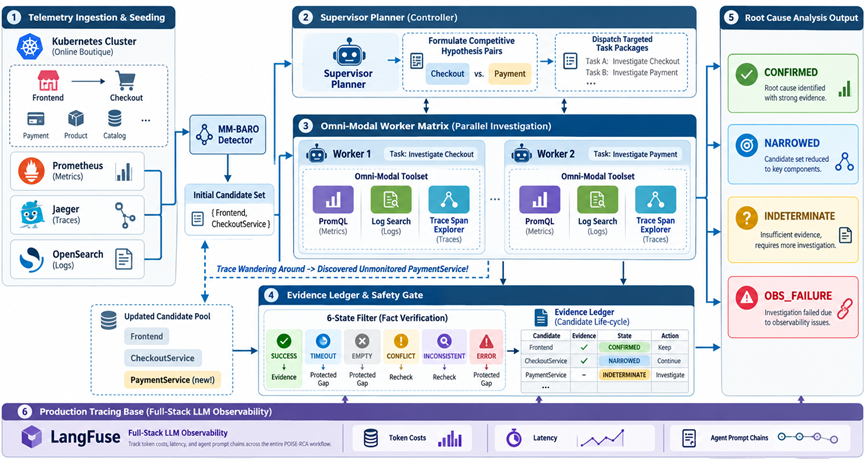

<p align="center">
  
</p>


<h1 align="center">POISE-RCA</h1>

POISE-RCA（Partial-Observation Investigation with Structured Evidence for Root Cause
Analysis）是一个面向云计算故障诊断的 LangGraph 原型系统。它重点解决以下问题：

> 当日志、指标或链路数据不完整时，诊断 Agent 应当给出与现有证据强度相匹配的结论，
> 明确说明缺失信息，而不是为了输出唯一根因而强行猜测。

## 系统架构



系统先复用 RCAEval 的 MM-BARO 静态分析提取带来源的异常，再据此生成任意数量的初始假设。
Supervisor 围绕候选假设之间的区别规划比较或挑战任务，并把每个任务交给上下文隔离的 Worker；
Worker 可以在同一次调查中组合日志、指标和链路查询，返回带证据引用的自然语言结论、未解决问题
以及新候选建议。最终结果不一定是唯一根因，而是以下四种分级状态之一：

| 状态                  | 含义                                         |
| --------------------- | -------------------------------------------- |
| `CONFIRMED`           | 证据满足确认条件，可以给出根因               |
| `NARROWED`            | 已缩小候选范围，但证据不足以确认唯一根因     |
| `INDETERMINATE`       | 当前观测无法区分候选假设                     |
| `OBSERVATION_FAILURE` | 数据源缺失、损坏或工具失败，无法形成有效诊断 |

## 核心特点

- 使用 LangGraph 显式控制静态分析后的假设生成、Supervisor 规划、Worker 调查、串行合并、审计和停止流程。
- 初始候选集不限定为两个；Worker 可以提出静态分析遗漏但能被观测证据连接到故障的新服务。
- 每个 Worker 只看到自己的任务、目标假设和相关证据，不共享其他 Worker 的对话上下文。
- Worker 输出实际观测、自然语言结论、证据引用、局限和新疑点，不输出固定的胜负枚举。
- `ACTIVE / DEFERRED / REFUTED / LEADING` 的转换由确定性守卫执行；任务完成或“未发现替代解释”本身不会改变状态。
- 正常停止依据候选和证据语义；`max_supervisor_steps` 只防止反复规划，达到上限时不会猜测根因。
- 工具超时属于运行保护，不是诊断预算或研究决策依据。
- 使用事件前基线与事件窗口进行异常比较，避免把长期存在的错误直接当作故障证据。
- 保留全部候选状态、Worker 结论与引用、候选增删、冲突证据、缺失证据和下一步人工建议。
- 可选接入 LangFuse，追踪安全的任务 ID、证据 ID、候选变化、生命周期转换和 Supervisor 步数。
- 原始遥测、运行结果和密钥默认不提交到 Git。

执行流程如下：

```text
加载案例与服务清单
        ↓
MM-BARO 静态分析并规范化异常
        ↓
生成任意数量的 ACTIVE 初始假设
        ↓
Supervisor 规划比较 / 挑战任务
        ↓
隔离 Worker 按需组合 Logs / Metrics / Traces
        ↓
串行合并证据、校验新候选与状态建议
        ↓
审计后继续规划或输出语义诊断报告
```

## 1. 环境准备

项目使用 Python 3.12 和 `uv` 管理依赖。先确认本机已经安装 `uv`：

```powershell
uv --version
```

如果尚未安装，请参考 [uv 官方安装说明](https://docs.astral.sh/uv/getting-started/installation/)。

在项目根目录执行：

```powershell
uv sync --locked
```

该命令会根据 `pyproject.toml` 和 `uv.lock` 创建本地虚拟环境并安装运行、测试所需依赖。

## 2. 配置模型

```powershell
$env:OPENAI_API_KEY = "你的 API Key"
$env:OPENAI_BASE_URL = "https://api.openai.com/v1"  # 可选
$env:POISE_RCA_MODEL = "gpt-4.1-mini"               # 可选，默认值见配置文件
```

环境变量清单可以参考 `.env.example`。当前 CLI 直接读取环境变量，不会自动加载 `.env` 文件。

默认运行参数位于：

```text
configs/default.yaml
```

MAS 和工具保护的核心配置为：

```yaml
mas:
  max_supervisor_steps: 10
tools:
  per_tool_timeout_seconds: 30
```

运行时依赖 `rcaeval` 提供 MM-BARO 静态分析实现。`uv sync --locked` 会一并安装该依赖及其明确声明的
`scikit-learn`、`tqdm` 运行依赖。

## 3. 数据集放在哪里

当前原型使用的实验数据是 RCAEval 的 RE2-OB 数据。默认数据根目录为：

```text
data/raw/rcaeval/
```

支持两种目录布局。

扁平布局：

```text
data/raw/rcaeval/
  re2ob_checkoutservice_delay_1/
    inject_time.txt
    metrics.json
    logs.csv
    traces.csv
```

原始嵌套布局：

```text
data/raw/rcaeval/
  RE2-OB/
    checkoutservice_delay/
      1/
        inject_time.txt
        metrics.json
        logs.csv
        traces.csv
```

每个案例必须包含 `inject_time.txt`，并可以包含下列任意可用观测：

- `metrics.json`、`metrics.csv` 或 `metrics.parquet`
- `logs.csv` 或 `logs.parquet`
- `traces.csv` 或 `traces.parquet`

如果希望把数据放在其他位置，可以设置：

```powershell
$env:POISE_RCA_DATASET_ROOT = "D:\Datasets\RCAEval"
```

原始数据目录已被 `.gitignore` 忽略，不应提交到 Git。

## 4. 从数据集中抽样

正式诊断前需要生成一个确定性的案例清单。清单包含安全案例 ID、数据位置和校验和，Agent
不会看到根因标签或原始数据路径。

生成 3 个案例的快速测试清单：

```powershell
uv run poise-rca sample --config configs/sampling/re2_ob_smoke.yaml
```

输出位置：

```text
data/manifests/re2_ob_smoke.json
```

生成 12 个案例的原型开发清单：

```powershell
uv run poise-rca sample --config configs/sampling/re2_ob_prototype_dev.yaml
```

输出位置：

```text
data/manifests/re2_ob_prototype_dev.json
```

`safe_case_id` 可以直接从对应清单中查看。

## 5. 启动诊断

本项目是命令行程序，不需要启动常驻 Web 服务。

### 诊断单个案例

```powershell
uv run poise-rca diagnose `
  --case-id <safe_case_id> `
  --manifest data/manifests/re2_ob_smoke.json `
  --config configs/default.yaml
```

命令完成后会输出该案例 `report.json` 的路径。

### 批量诊断抽样案例

```powershell
uv run poise-rca batch `
  --manifest data/manifests/re2_ob_smoke.json `
  --config configs/default.yaml
```

如需运行 12 个开发案例，将清单替换为：

```text
data/manifests/re2_ob_prototype_dev.json
```

## 6. 结果在哪里看

默认结果根目录为：

```text
results/
```

单案例诊断结果：

```text
results/
  <run-id>/
    <safe-case-id>/
      report.json
      state.json
```

批量诊断结果：

```text
results/
  batch-<timestamp>-<id>/
    summary.json
    <safe-case-id>/
      report.json
      state.json
```

各文件用途如下：

| 文件           | 内容                                                         |
| -------------- | ------------------------------------------------------------ |
| `report.json`  | 最终状态与精确停止原因、所有候选的四态生命周期和因果角色、Worker 自然语言结论及引用、未解决问题、候选提升/拒绝、Supervisor 步数、根因或剩余候选、缺失证据和人工建议 |
| `state.json`   | LangGraph 最终结构化状态，适合调试完整调查过程               |
| `summary.json` | 批处理案例数量、各状态计数及每个案例的报告路径               |

可以通过环境变量修改结果根目录：

```powershell
$env:POISE_RCA_RESULTS_ROOT = "D:\Results\POISE-RCA"
```

结果目录属于运行产物，默认不会提交到 Git。

## 7. 可选：接入 LangFuse

不配置 LangFuse 时，系统仍会正常运行并在本地生成结果。要启用链路追踪，可以设置：

```powershell
$env:LANGFUSE_PUBLIC_KEY = "pk-lf-..."
$env:LANGFUSE_SECRET_KEY = "sk-lf-..."
$env:LANGFUSE_BASE_URL = "https://cloud.langfuse.com"  # 或自建地址
$env:LANGFUSE_TRACING_ENVIRONMENT = "development"
```

配置成功后，可以在 LangFuse 中查看静态分析摘要、独立的假设生成/Supervisor/Worker 调用、任务与
证据 ID、候选变化、生命周期转换、审计和报告生成链路。`report.json` 中的 `trace_id` 可用于关联
本地结果与 LangFuse trace。原始日志、指标和链路行默认不会上传。

## 8. 项目目录

```text
MAS-RCA/
  configs/                 # 默认运行配置和抽样配置
  data/
    raw/rcaeval/           # 本地 RCAEval 原始数据
    manifests/             # 确定性抽样清单
  results/                 # 本地诊断结果
  scripts/                 # 仓库安全检查脚本
  src/poise_rca/
    agents/                # 假设生成、Supervisor、Worker 和证据审计
    analysis/              # 静态分析边界与 RCAEval MM-BARO 适配器
    data/                  # RCAEval 加载、清单和抽样
    domain/                # 证据、假设、任务等结构化模型
    graph/                 # LangGraph 状态、节点、路由和停止条件
    observability/         # LangFuse 追踪
    reporting/             # 诊断报告模型与写入
    tools/                 # Logs、Metrics、Traces 查询工具
  tests/                   # 单元测试、集成测试和合成数据
```

## 9. 测试与检查

运行完整测试：

```powershell
uv run pytest -v
```

运行代码质量检查：

```powershell
uv run ruff check .
uv run ruff format --check .
uv run mypy src
uv run python scripts/verify_no_tracked_artifacts.py
git diff --check
```

合成集成测试覆盖：三个以上初始假设、比较性证据、新候选提升、遥测不可用、多层非互斥因果、
challenge 未发现替代解释时不误晋升，以及达到 `max_supervisor_steps` 时不强行归因。仓库中的
`tests/fixtures/synthetic_case/` 仅用于验证流程和安全约束，不用于评估真实根因诊断准确率。

## 10. 数据与 Git 规范

允许提交：

- 源代码、测试、Prompt 和文档
- `pyproject.toml`、`uv.lock` 和默认配置
- 经过选择的 `data/manifests/*.json`

禁止提交：

- 原始或处理后的遥测数据
- `results/`、日志、LangGraph checkpoint 和 LangFuse 导出
- `.env`、API Key、证书和其他凭据
- 模型权重、数据库和任意实验缓存

`scripts/verify_no_tracked_artifacts.py` 会检查 Git 索引，防止通过强制添加意外提交运行产物。
